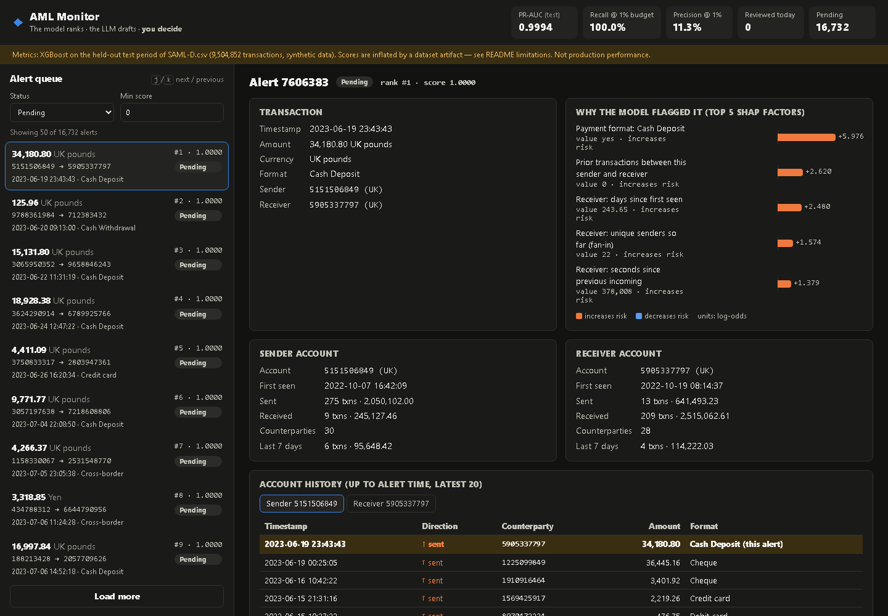

# AML Transaction Monitoring

An end-to-end anti-money-laundering (AML) monitoring prototype. It scores transactions, explains each alert with SHAP, has an LLM draft a SAR-style narrative, and gives an analyst a web UI to review alerts and record decisions.

> **The model ranks. The LLM drafts. A human decides.**
> The LLM never makes or records a decision. It turns grounded facts into readable text, and a validator rejects any draft containing a number, account, date or time that isn't in those facts.



Everything runs locally on a laptop with plain Python. There's no Docker and no cloud dependency; the LLM is optional.

---

## Contents

1. [Architecture](#architecture)
2. [Quick start](#quick-start)
3. [Dataset](#dataset)
4. [Pipeline](#pipeline)
5. [Results](#results)
6. [Why the scores are this high](#why-the-scores-are-this-high-read-this-first)
7. [The alert budget](#the-alert-budget)
8. [False positives](#false-positives)
9. [Explanations (SHAP)](#explanations-shap)
10. [LLM narratives: drafts only](#llm-narratives-the-llm-only-drafts-the-human-decides)
11. [API](#api)
12. [Tests](#tests)
13. [Project structure](#project-structure)
14. [Limitations](#limitations)

---

## Architecture

```mermaid
flowchart LR
    subgraph Offline["Offline: python -m src.pipeline train"]
        A[SAML-D CSV<br/>9.5M txns] --> B[src/data<br/>load · clean · time split 60/20/20]
        B --> C[src/features<br/>57 strictly-past features<br/>+ optional graph snapshots]
        C --> D1[Isolation Forest<br/>baseline]
        C --> D2[XGBoost<br/>class-weighted]
        D2 --> E[Threshold = top 1%<br/>of validation scores]
        E --> F[src/eval<br/>PR-AUC · recall@1% · error analysis]
        E --> G[src/explain<br/>SHAP top-5 per alert]
        G --> H[(SQLite<br/>alerts · history)]
    end

    subgraph Online["Online: uvicorn src.api.main:app"]
        H --> I[FastAPI]
        I --> J[src/llm facts]
        J --> K{LLM provider?}
        K -- OpenAI / Gemini --> L[Draft JSON]
        K -- no key --> M[Template]
        L --> N[Validator<br/>numbers · IDs · dates · timeline]
        N -- fail, 1 retry --> L
        N -- still failing --> M
        N -- pass --> O[Narrative draft]
        M --> O
        O --> P[Analyst UI<br/>HTML + CSS + vanilla JS]
        P -- approve / dismiss + note --> Q[(SQLite<br/>decisions: audit trail)]
    end
```



| Layer | Code | What it does |
|---|---|---|
| Data | [src/data](src/data) | Auto-detects SAML-D or IBM HI-Small, maps them to one canonical schema, sorts by time, splits 60/20/20 by time (never randomly) |
| Features | [src/features](src/features) | Rolling counts and amounts (1h/24h/7d), velocity, fan-in/out, pass-through, account age, flags; all strictly before each transaction |
| Models | [src/models](src/models) | Isolation Forest baseline; class-weighted XGBoost; threshold chosen for the alert budget |
| Evaluation | [src/eval](src/eval) | PR-AUC, recall@1%, precision@k, confusion matrix, per-typology error analysis, charts |
| Explain | [src/explain](src/explain) | SHAP TreeExplainer; top-5 factors per alert; writes the alert store |
| LLM | [src/llm](src/llm) | Facts → OpenAI/Gemini/template draft → grounding validator → retry → fallback |
| API + UI | [src/api](src/api), [frontend](frontend) | FastAPI endpoints; static single-page UI with no framework or build step |

---

## Quick start

Tested on Windows 11, Python 3.12, 8 logical cores, 16 GB RAM. The code is plain Python 3.11+.

### 1. Install

```bash
pip install pandas pyarrow numpy scikit-learn xgboost shap networkx fastapi uvicorn pydantic python-dotenv httpx openai matplotlib pytest
```

### 2. Get the data

Download **SAML-D** ("Synthetic Anti-Money Laundering Dataset", Oztas et al., 2023; available on Kaggle) and either place `SAML-D.csv` at `data/raw/SAML-D.csv` or point to it in `.env`.
The loader also accepts IBM's **HI-Small** (`HI-Small_Trans.csv`, plus `HI-Small_Patterns.txt` for typologies).

### 3. Configure

```bash
cp .env.example .env
```

```ini
AML_DATA_PATH=C:/path/to/SAML-D.csv
LLM_PROVIDER=template          # or: openai | gemini
OPENAI_API_KEY=                # only if LLM_PROVIDER=openai
OPENAI_MODEL=gpt-4o-mini
```

`.env` is git-ignored. Never commit API keys.

### 4. Train, evaluate and build the alert store

```bash
python -m src.pipeline train --sample 1000000   # quick dev run on the earliest 1M rows (a few minutes)
python -m src.pipeline train --graph            # full 9.5M rows (~38 min on the machine above)
```

This writes `models/xgb_model.json`, `models/metrics.json`, `models/error_analysis.json` and `data/aml.db`.
To rebuild only the alerts from the saved model (~5 min), run `python -m src.pipeline build-alerts`.
To run the offline demo without the real dataset, use `python -m src.pipeline train --synthetic` (tiny generated data with meaningless metrics).

### 5. Review alerts

```bash
python -m uvicorn src.api.main:app --reload
```

Open <http://127.0.0.1:8000>. Use `j`/`k` to move through the queue.

### Other commands

| Command | Purpose |
|---|---|
| `python -m src.models.baseline [--sample N] [--graph]` | Isolation Forest baseline only |
| `python -m src.eval.error_analysis` | Per-typology recall and false-positive tables |
| `python -m src.eval.plot_baseline` | Baseline charts → `output-graphs/` |
| `python -m src.llm.generator --top 3` | Print narrative drafts for the top alerts |
| `python -m pytest` | Test suite |

---

## Dataset

**SAML-D**: 9,504,852 synthetic transactions between 855,460 accounts, from 2022-10-07 to 2023-08-23. 9,873 (0.104%) are labelled laundering across 17 laundering typologies, alongside 11 normal behaviour types. `Amount` is already in one base currency (GBP), so no FX conversion is applied. For HI-Small, rates are derived from the data's own cross-currency rows.

The `Laundering_type` column is used **only for error analysis**. It encodes the label (`Normal_*` vs laundering types), so it is never a model feature.

Time-based split (cut points are timestamps, so no timestamp straddles two splits):

| Split | Period | Rows | Laundering | Rate |
|---|---|---:|---:|---:|
| train | 2022-10-07 → 2023-04-16 | 5,702,911 | 5,742 | 0.101% |
| validation | 2023-04-16 → 2023-06-19 | 1,900,970 | 1,988 | 0.105% |
| test | 2023-06-19 → 2023-08-23 | 1,900,971 | 2,143 | 0.113% |

---

## Pipeline

**Features (57).** Each transaction at time *t* sees only transactions in `[t − window, t)`. Rows with the same timestamp are excluded too, so nothing from the present or future can leak in. This is implemented with sorted composite keys and binary search ([src/features/windows.py](src/features/windows.py)), which builds all features for 9.5M rows in about 3 minutes. The features are:
- per-account rolling count and amount over 1h, 24h and 7d (sender outgoing, receiver incoming)
- velocity (24h outflow vs 7-day daily average) and time since previous transaction
- fan-out and fan-in (unique counterparties so far), plus new counterparties in the last 7 days
- prior transactions between the same pair
- pass-through (money received by the sender in the last 24h or 7d)
- account age
- cross-border, cross-currency, round-amount and just-below-10k flags
- hour, weekday and payment format
- optional `--graph`: connected-component size and cycle membership (strongly connected components) from monthly snapshots of the **past** transaction graph (NetworkX)

**Models.** The Isolation Forest baseline is unsupervised (200 trees, fitted on a 200k-row training sample). XGBoost uses `scale_pos_weight` = negatives/positives (≈ 992), `hist` trees, depth 6 and eta 0.05, with early stopping on validation PR-AUC. The seed is fixed at 42.

**Threshold.** It is set to flag the top 1% of *validation* scores, then applied unchanged to *test* (see [The alert budget](#the-alert-budget)).

**Metrics.** The headline metrics are PR-AUC and recall at the 1% budget. Accuracy is meaningless at a 0.1% positive rate: flagging nothing scores 99.9%. ROC-AUC flatters a model by rewarding it for ranking millions of easy negatives. Neither is used as a headline metric.

---

## Results

All numbers below come from `models/metrics.json` and `models/error_analysis.json`, produced by `python -m src.pipeline train --graph` on the full dataset. Nothing is hand-entered.

### Full dataset: test split (held-out final 20% of time)

| Model | PR-AUC | Random baseline | Recall @ 1% budget | Precision @ 1% budget | Precision @ 100 |
|---|---:|---:|---:|---:|---:|
| **XGBoost** | **0.9994** | 0.0011 | **100.0%** | 11.3% | 100% |
| Isolation Forest | 0.0018 | 0.0011 | 1.3% | 0.15% | 0% |

Confusion matrix on test at the threshold chosen on validation:

| XGBoost | Predicted alert | Not alerted |
|---|---:|---:|
| **Laundering** | 2,143 (TP) | 0 (FN) |
| **Legitimate** | 14,589 (FP) | 1,884,239 (TN) |

Realised test alert rate: 0.88% (16,732 alerts). Precision at that threshold: 12.8%.
Validation: PR-AUC 0.9968, recall@1% 100%, precision@1% 10.5%.

### Time-ordered 1M-row sample (earliest ~1 month), test split

| Model | PR-AUC | Random baseline | Recall @ 1% | Precision @ 100 |
|---|---:|---:|---:|---:|
| XGBoost | 0.528 | 0.0008 | 86.3% | 71% |
| Isolation Forest | 0.0008 | 0.0008 | 0% | 0% |

The same code goes from 0.53 to 0.9994 PR-AUC once its training window covers about 6 months of history instead of about 3 weeks. The next section explains why.

### Error analysis by typology (test)

- **XGBoost** catches 100% of every one of the 17 laundering typologies on test, which is consistent with the artifact below.
- **Isolation Forest** finds only large one-off amounts. It catches Over-Invoicing at 30%, though that is 3 of only 10 transactions, Single_large at 6.7% and Cash_Withdrawal at 5.1%. It catches **0%** of Cycle, Fan_In, Smurfing, Bipartite, Stacked Bipartite, Scatter-Gather, Gather-Scatter and Behavioural_Change_1. Those network and behavioural patterns aren't statistical outliers.

Baseline charts are in [output-graphs/](output-graphs): split overview, precision-recall curve, recall vs budget, score distributions, recall by typology, and false positives by type.

---

## Why the scores are this high (read this first)

A PR-AUC of 0.9994 would be extraordinary on real bank data. Here it comes from **how SAML-D was generated**, not from leakage:

| | Laundering pairs | Normal pairs |
|---|---:|---:|
| Transactions per sender→receiver pair (median) | **1** | **12** |
| Pairs used only once | **98.1%** | 11.2% |
| Pairs appearing in both classes | 0 | 0 |

In SAML-D, laundering is almost always a **first-ever payment between two accounts**, while normal customers keep paying the same counterparties. With months of history, "these two accounts have never transacted" combined with cash deposit or withdrawal almost separates the classes on its own. `pair_prev_count` alone carries 35% of the model's total gain, and the cash payment formats carry another 19%.

**This is not leakage:**
- **No future data.** Every feature uses only strictly earlier transactions, and that is tested: truncating or perturbing future rows never changes past features.
- **No label input.** No feature uses labels or the typology column.
- **Graph features aren't the cause.** None of them is in the top 15 by importance.

The behaviour is still unrealistic. Real customers make legitimate first-time payments all the time, and real launderers reuse counterparties. **Treat the 1M-sample result (PR-AUC 0.53) as a better sense of difficulty, and treat none of these numbers as production performance.** A useful next experiment is an ablation without the pair-novelty features.

---

## The alert budget

Real AML teams can review only a fixed number of alerts. The question isn't "what's the most accurate threshold?" but **"if we can review 1% of transactions, which 1% should they be?"**

- The threshold is the score above which 1% of **validation** transactions fall. It is chosen before looking at test.
- The same threshold is applied to **test**, so the realised test alert rate shows how the budget holds up on future data. Here it was 0.88% rather than exactly 1%, which is normal drift.
- *Recall at 1%* (top 1% of each split, ranked) and *precision@k* measure ranking quality inside the budget.

With roughly 1,900 laundering transactions per two-month split and a budget of about 19,000 alerts, even a perfect ranker has a precision ceiling of about 11% at this budget. In production, the budget would be tuned to analyst capacity, and probably set much lower.

---

## False positives

At the 1% budget, **about 87% of alerts are false positives** (14,589 of 16,732 on test). That is normal for AML monitoring, and it is why explanations and narrative drafts exist: to make each review fast.

Where the test false positives come from (legitimate behaviour types in SAML-D):

| Legitimate type | Flagged | False-positive rate for that type | Share of all false positives |
|---|---:|---:|---:|
| Normal_Cash_Deposits | 4,461 | 9.9% | 30.6% |
| Normal_Foward | 4,192 | 49.4% | 28.7% |
| Normal_Cash_Withdrawal | 2,931 | 4.9% | 20.1% |
| Normal_Fan_Out | 574 | 0.1% | 3.9% |
| Normal_Mutual | 541 | 2.2% | 3.7% |
| *others (6 types)* | 1,890 | – | 13.0% |

These are exactly the legitimate behaviours that resemble laundering signals: cash in and out, and forwarding money that just arrived. The ranking helps here. On test the **top 2,095 alerts are all true laundering**, and the first false positive appears at rank 2,096. An analyst working top-down would see false positives only after clearing every real case. On real data, this is where reviewers would build suppression rules, for example for known payroll or forwarding relationships. Every one of those rules needs documented justification.

---

## Explanations (SHAP)

Each alert stores its **top 5 SHAP factors** (TreeSHAP on the exact trees used for scoring), with a readable label, the feature value, signed contribution in log-odds, and direction. Additivity was checked on the real model: base value + Σ SHAP equals the model's log-odds output, with a maximum error of 2×10⁻⁵ over 200 alerts.

Example for the #1 alert, a £34,180.80 cash deposit:

```
+5.976  Payment format: Cash Deposit                          yes
+2.620  Prior transactions between this sender and receiver  0
+2.480  Receiver: days since first seen                      243.65
+1.574  Receiver: unique senders so far (fan-in)             22
+1.379  Receiver: seconds since previous incoming            378,008
```

In the UI these are diverging bars, orange for factors that increase risk and blue for factors that decrease it. The direction is also written out, so colour is never the only cue.

---

## LLM narratives: the LLM only drafts, the human decides

**Boundary**

| The system does | The system never does |
|---|---|
| Rank transactions and pick alerts within the budget | Escalate, file a SAR, freeze or close an account |
| Explain each alert with SHAP | Record a decision on its own |
| Draft a narrative from grounded facts | Show the analyst the ground-truth label |
| Validate and label each draft's provenance | Present a draft as a conclusion |

Approve or dismiss is a button only a human can press. A written note is mandatory, and decisions are append-only rows in SQLite (an audit trail). The analyst's edited narrative is saved with the decision.

**How a draft is made** ([src/llm](src/llm))

1. **Facts.** The alerted transaction, top-5 SHAP factors, sender and receiver summaries up to the alert time, and the last 8 history transactions.
2. **Draft.** The provider is set with `LLM_PROVIDER` (`openai` uses JSON mode with `gpt-4o-mini` by default; `gemini` uses the REST API). The output must match the Pydantic `SARNarrative` schema: `summary`, `suspicious_indicators[]`, `timeline[]`, `recommended_action` (for human review only).
3. **Validate.** Every date, time, account ID and number in the text must exist in the facts. Rounding and thousands separators are allowed. Each timeline event must match a real transaction by timestamp, and its amounts and accounts must belong to that transaction. Decision language ("a SAR has been filed", "account frozen") is rejected.
4. **Regenerate once** with the validator's findings, then **fall back to a deterministic template** if the LLM still fails. Auth errors skip the retry. With no API key, the template is used directly.
5. The UI shows the draft's **provenance badge**: validated, validated after retry, or template fallback. Rejected drafts' findings can be expanded.

**Measured with gpt-4o-mini** on 10 alerts across the queue: 9 passed on the first try, 1 passed after regeneration (it had written a bare "2023" that isn't in the facts), and 0 fell back. The template passed validation on 101 of 101 sampled alerts.

**A failure that shaped the validator.** In an early run, gpt-4o-mini put the alerted amount (34,180.80) on an *earlier* timeline row whose real amount was 18,924.53. The first validator passed it, because the number existed somewhere in the facts. The timeline consistency check was added because of this, and a test reproduces it.

---

## API

| Method | Path | Description |
|---|---|---|
| GET | `/api/alerts?limit=&offset=&min_score=&status=` | Ranked queue; `status` = `pending` \| `approved` \| `dismissed` |
| GET | `/api/alerts/{id}` | Details, SHAP factors, features, account summaries, history (≤ alert time), latest narrative and decision |
| POST | `/api/alerts/{id}/narrative` | Generate or regenerate a validated draft; optional body `{"provider": "openai" \| "gemini" \| "template"}` |
| POST | `/api/alerts/{id}/decision` | `{"decision": "approve" \| "dismiss", "note": "...", "narrative_text": "..."}`; note required |
| GET | `/api/metrics` | Test metrics plus queue counters (pending, approved, dismissed, reviewed today) |
| GET | `/` | Analyst UI (`frontend/`, served from `/static`) |

Interactive docs are at `/docs`. Ground-truth columns exist in the database for offline evaluation but are never returned by any endpoint, and a test enforces this.

**UI:**
- ranked queue with status and min-score filters
- `j`/`k` keyboard navigation
- SHAP bars, account history with the alerted row highlighted
- editable narrative and the approve/dismiss form
- loading, error and empty states
- light and dark themes, and a single-column layout on narrow screens
- all DOM built without `innerHTML`, so LLM text can't inject markup

---

## Tests

```bash
python -m pytest     # 41 tests, ~20 s
```

| File | Covers |
|---|---|
| `test_leakage.py` | Truncating or perturbing future (and same-timestamp) rows never changes earlier features, including graph features; window counts match brute force |
| `test_split.py` | Time ordering, 60/20/20 fractions, no timestamp straddles a split, schema detection |
| `test_metrics.py` | precision@k, recall@budget, confusion matrix, budget threshold |
| `test_shap.py` | SHAP matrix shape, additivity, top-5 ordering and direction, alert ranking |
| `test_validator.py` | Catches a wrong number, unknown account, wrong date or time, amount on the wrong timeline row, decision language; regeneration and template fallback with fake LLMs |
| `test_api.py` | End-to-end on a synthetic store in a temp dir (LLM forced to template): queue, filters, detail, 404/422, narrative, decision flow, metrics, no label leakage |

---

## Project structure

```
data/raw/              # input CSV (not committed)
data/aml.db            # alert store + decisions (generated, not committed)
models/                # xgb_model.json, metrics.json, error_analysis.json
output-graphs/         # baseline charts
docs/                  # README images
src/
  config.py            # settings from env/.env; seed, alert budget
  pipeline.py          # train / build-alerts CLI
  data/                # loader (SAML-D + HI-Small), time split, synthetic generator
  features/            # windows.py (strictly-past stats), build.py, graph.py
  models/              # baseline.py, xgb.py, threshold.py
  eval/                # metrics.py, error_analysis.py, plot_baseline.py
  explain/             # shap_explain.py, alerts.py
  llm/                 # schema, facts, providers, template, validator, generator
  api/                 # main.py (FastAPI), schemas.py, db.py (SQLite)
frontend/              # index.html, styles.css, app.js
tests/
```

---

## Limitations

- **Synthetic data.** SAML-D is simulated. Its laundering is unusually separable (98% single-use counterparty pairs), so the 0.9994 PR-AUC doesn't predict real-world performance. Real transaction data has messier behaviour, label noise, and labels that arrive months later.
- **Limited typology coverage.** The model learns the 17 typologies the simulator produces. It hasn't been tested on trade-based laundering beyond over-invoicing, crypto, mule networks across institutions, or adversaries adapting to the model.
- **One institution's view.** Features use only this dataset's transactions. A real bank sees one side of many cross-bank flows.
- **Static model.** It is trained once on a fixed period, with no drift monitoring, retraining schedule or champion/challenger setup.
- **Validator scope.** The validator checks numbers, IDs, dates, times and timeline consistency, not meaning. In testing, a draft claimed two accounts "have a history of prior transactions" when there were none, and it passed. Analysts must read every draft critically; it is a starting point, not evidence.
- **LLM data handling.** With `openai` or `gemini`, alert facts (account IDs, amounts, history) are sent to a third-party API. Real customer data would require a data-processing agreement, data minimisation or pseudonymisation, or a self-hosted model.
- **Prototype security.** There is no authentication, no per-analyst identity, no role-based access, and no encryption at rest for the SQLite file.
- **Regulatory review needed before production.** Model risk management, such as SR 11-7–style validation or equivalent, documented thresholds and suppression rules, fairness review, explainability sign-off and an approved SAR workflow, would all be required. Nothing here is regulatory advice.
